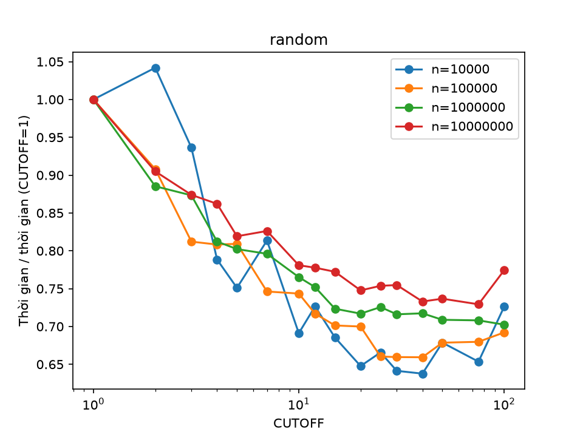
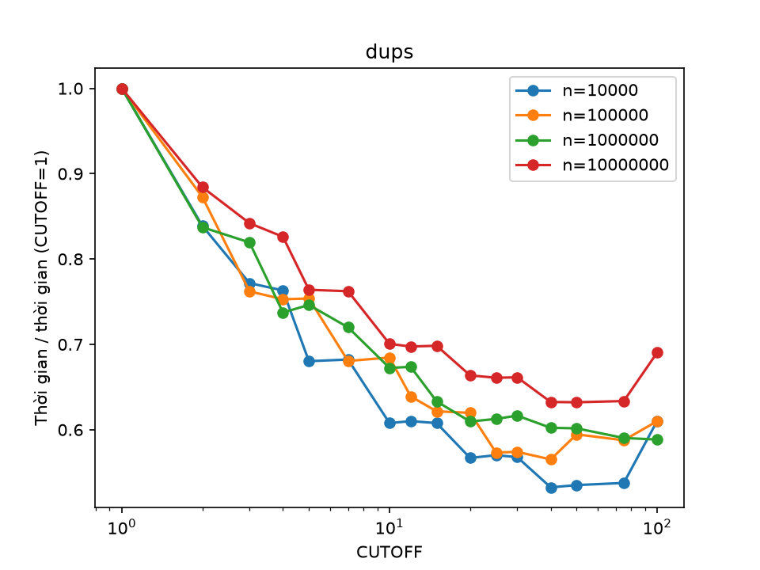
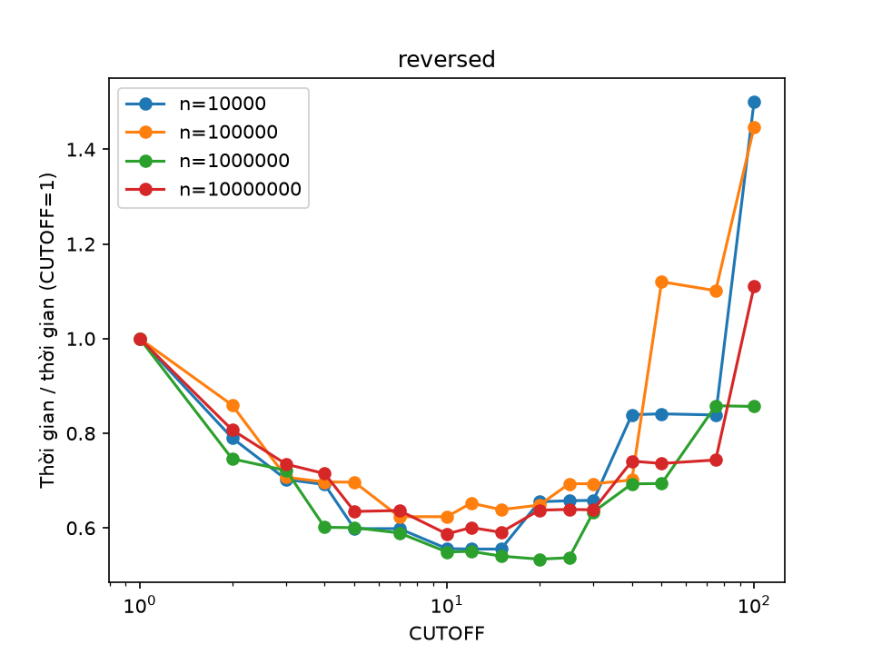
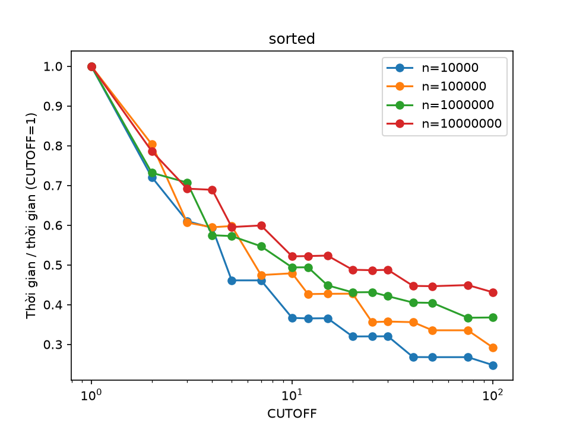
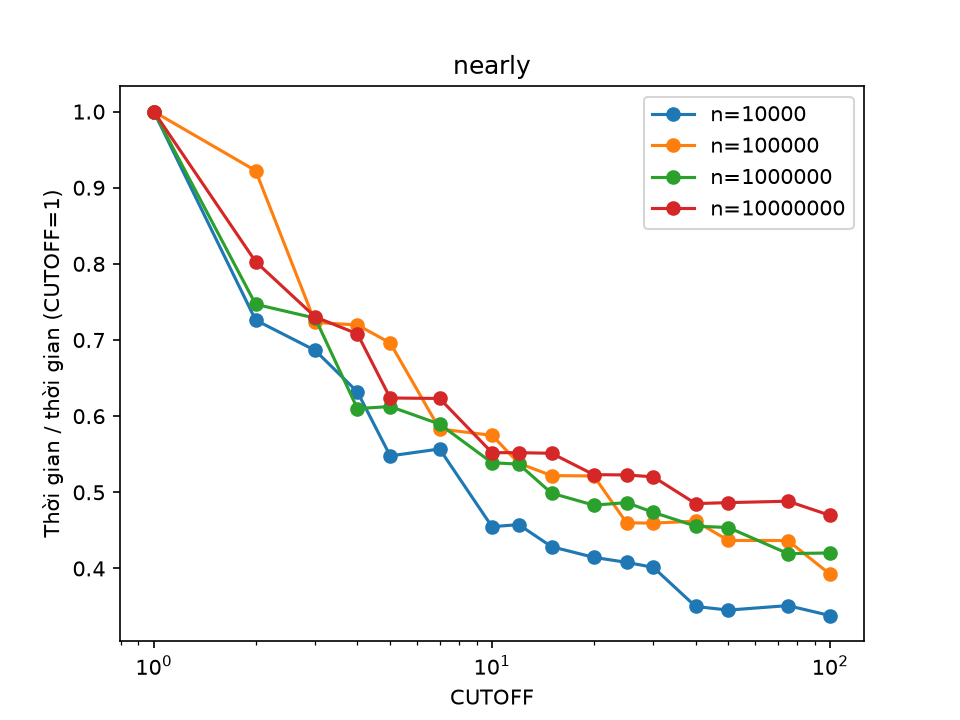

# Cutoff-test
1. Mức cải thiện so với mergesort thuần (CUTOFF = 1)

Thời gian median ở CUTOFF tốt nhất (ms), so với CUTOFF = 1:

Loại	n = 10⁴	n = 10⁵	n = 10⁶	n = 10⁷
random	0.95 → 0.60	10.81 → 7.13	123.6 → 86.8	1388 → 1012
dups	0.83 → 0.44	8.43 → 4.77	90.5 → 53.2	928 → 586
reversed	0.34 → 0.19	3.87 → 2.42	55.1 → 29.4	592 → 348
sorted	0.46 → 0.11	5.03 → 1.47	55.9 → 20.5	606 → 261
nearly	0.44 → 0.15	4.74 → 1.86	62.8 → 26.3	643 → 302

Với dữ liệu random, cải thiện khoảng 27% (n = 10⁷) đến 37% (n = 10⁴).

2. CUTOFF tối ưu theo từng cấu hình

Cột “không phân biệt được” là các CUTOFF mà thời gian không khác có ý nghĩa thống kê so với CUTOFF tốt nhất (p > 0.05).

Loại	n	CUTOFF tốt nhất	Không phân biệt được với tốt nhất
random	10⁴	40	5 đến 100 (nhiễu rất lớn, CV ≈ 39%)
random	10⁵	40	25, 30, 40
random	10⁶	100	50, 75, 100
random	10⁷	75	20, 25, 40, 50, 75
dups	10⁴ / 10⁵ / 10⁶ / 10⁷	40 / 40 / 100 / 50	{40, 50} / {25–40} / {75, 100} / {40–75}
reversed	10⁴ / 10⁵ / 10⁶ / 10⁷	12 / 7 / 20 / 10	{10–15} / {7, 10} / {20, 25} / {10–15}
sorted	mọi n	75 đến 100 (biên của khảo sát)	chưa xác định được đáy
nearly	mọi n	75 đến 100 (biên của khảo sát)	chưa xác định được đáy
3. Nhận xét

Random. Thời gian giảm nhanh khi CUTOFF tăng từ 1 đến khoảng 10, rồi thoải dần và phẳng trong vùng 20 đến 75. Với n = 10⁷, vùng 20 đến 75 chênh nhau chỉ khoảng 2 đến 3% (tỉ lệ 0.73 đến 0.75) và không phân biệt được về thống kê. Tại CUTOFF = 100, n = 10⁷ tăng lại (0.774, trung bình 1081 ms so với 1022 ms ở CUTOFF 40), cho thấy chi phí O(k²) của insertion sort bắt đầu lấn át.

Dups. Xu hướng giống random nhưng cải thiện mạnh hơn (tỉ lệ 0.53 đến 0.63). Vùng tốt nằm quanh 40 đến 75. Ở n = 10⁴ và 10⁷ thời gian tăng lại tại 100.

Reversed. Đường cong chữ U rõ nhất. Đáy nằm ở khoảng 7 đến 25, tùy n (tỉ lệ ≈ 0.53 đến 0.65). Từ 40 trở lên thời gian tăng, và tại CUTOFF = 100 với n = 10⁴, 10⁵, 10⁷ chậm hơn mergesort thuần (tỉ lệ 1.50, 1.45, 1.11). Riêng n = 10⁶ ở CUTOFF 100 vẫn còn 0.857, nên cách nói “chậm hơn baseline” chỉ đúng với ba kích thước kia (nhận xét lần trước của mình nói chung chung chỗ này).

Sorted và nearly. Thời gian giảm đều theo CUTOFF và đáy nằm ở biên 75 đến 100 (tỉ lệ 0.25 đến 0.47), vì insertion sort chạy gần O(k) trên mảng có thứ tự. Với hai loại này, cần mở rộng CUTOFF lên 200, 500, 1000 mới kết luận được điểm tối ưu.

Ảnh hưởng của n.

Mức cải thiện giảm khi n tăng (random: 0.64 ở n = 10⁴, 0.73 ở n = 10⁷), vì ở n lớn các tầng merge phía trên và truy cập bộ nhớ chiếm tỉ trọng lớn hơn, phần tiết kiệm ở tầng đáy nhỏ lại tương đối.
Vị trí đáy khá ổn định theo n, luôn nằm trong vùng khoảng 20 đến 75 với random và dups.
Random n = 10⁴ nhiễu rất lớn (hệ số biến thiên trung vị ≈ 39%, trong khi các n khác chỉ 1 đến 3%). Vì thế các dao động ở n = 10⁴ (ví dụ CUTOFF 2 đến 10) không nên diễn giải, và kết luận nên dựa vào n ≥ 10⁵.
4. So sánh với giá trị giáo trình (7 và 10)

So với CUTOFF tốt nhất của từng cấu hình (n ≥ 10⁵, đều có p < 0.001):

	random	dups	reversed
CUTOFF = 7 chậm hơn	13%	20 đến 22%	0 đến 10%
CUTOFF = 10 chậm hơn	7 đến 13%	11 đến 21%	0 đến 3%

Vậy 7 và 10 đã lấy được phần lớn lợi ích so với CUTOFF = 1 (từ 1.00 xuống khoảng 0.77 đến 0.83 ở random), nhưng trên máy này vẫn còn kém vùng tối ưu khoảng 7 đến 13% với random và dups. Với reversed thì 10 gần như tối ưu.

5. Lựa chọn khuyến nghị

Lấy trung bình tỉ lệ thời gian (so với CUTOFF = 1) qua các n ≥ 10⁵:

Trên cả 5 loại dữ liệu: tốt nhất ở 25 đến 40 (0.573 đến 0.578).
Trên 3 loại không có sẵn thứ tự (random, dups, reversed): tốt nhất ở 20 đến 25 (0.651 đến 0.653), tăng lên 0.672 ở 40 và 0.723 ở 50.

Kết luận: CUTOFF nên chọn trong khoảng 20 đến 30, nếu cần một con số thì chọn 25. Giá trị này nằm trong vùng phẳng của random và dups, nằm trên đáy của reversed (7 đến 25), và chưa rơi vào vùng tăng vọt của reversed (từ 40). Với dữ liệu đã/gần sắp xếp thì CUTOFF lớn hơn còn có lợi thêm.
## Kết quả thí nghiệm

### Dữ liệu ngẫu nhiên (random)

### Nhiều phần tử trùng (dups)

### Sắp xếp ngược (reversed)

### Đã sắp xếp (sorted)

### Gần như đã sắp xếp (nearly)

